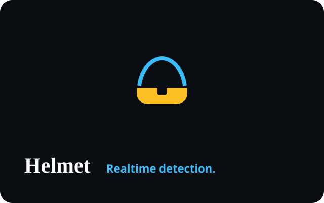

<!-- portfolio-sync:start -->

  

# Real-Time Helmet Detection

  

Safety-first vision system for helmet detection in traffic scenes (PyTorch / YOLO / OpenCV).

**Live demo:** [https://yashthavkar.com/helmet.html](https://yashthavkar.com/helmet.html)  
**Portfolio write-up:** [https://yashthavkar.com/project-detail.html?p=helmet-detection](https://yashthavkar.com/project-detail.html?p=helmet-detection)

---
<!-- portfolio-sync:end -->
# Helmet-Detection-

An AI based helmet detection , which can detect the helmets from the images with 99% accuracy . It is implemented using Opencv, Python, YOLOV3 .

Use pretrained model which i had added in the directory named ''yolo-coco'' to detect any helmet in the real time video.

------------

Create a folder named - Output
And just hit this - ' python livehelmet.py --output output/my.avi --yolo yolo-coco '

-----------

For Running the live interface helemt detection -

python livehelmet1.py --output images/myvideo.avi --yolo yolo-coco/

------------

If you like the code , you can take a minute to endorse me here
https://www.linkedin.com/in/yashthavkar/

-------------------------
You will need the weights file, which i have not uploaded here, if needed you can ping me on linkedin.
-------------------------

